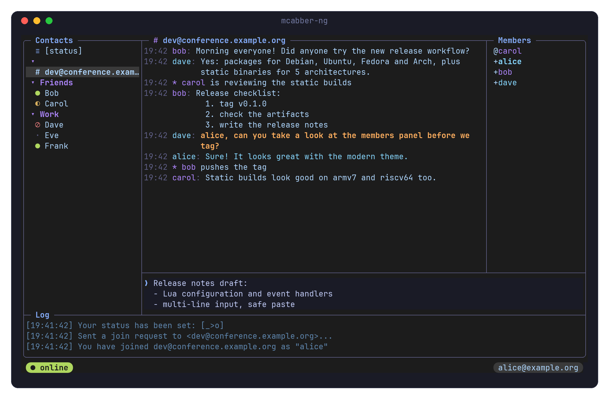
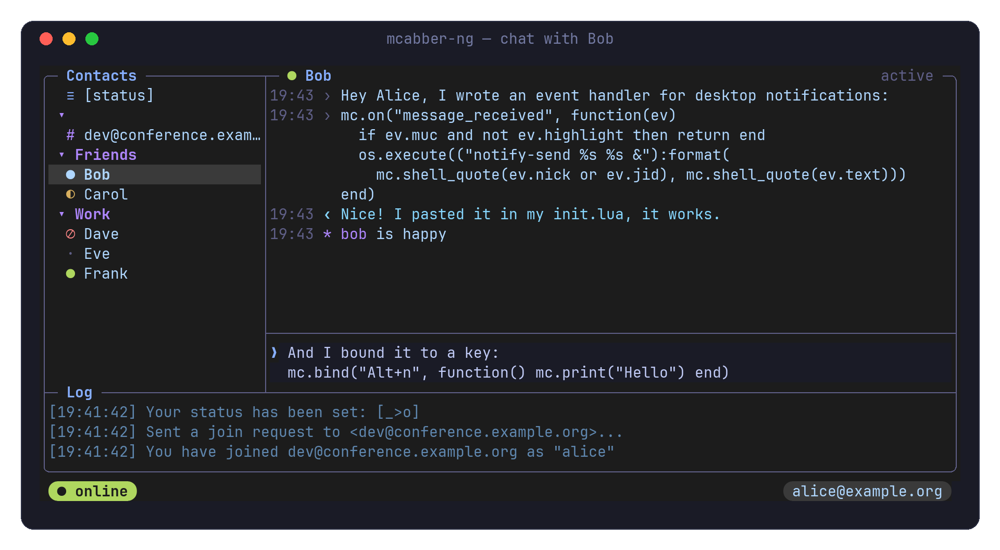
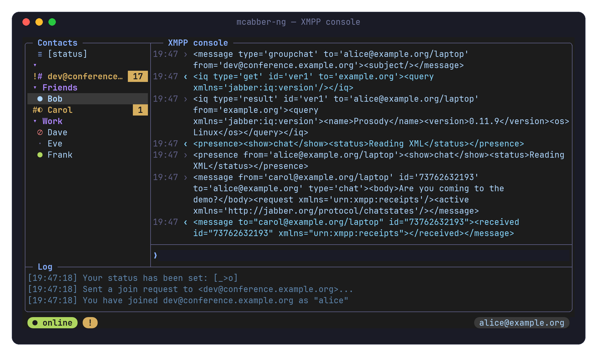
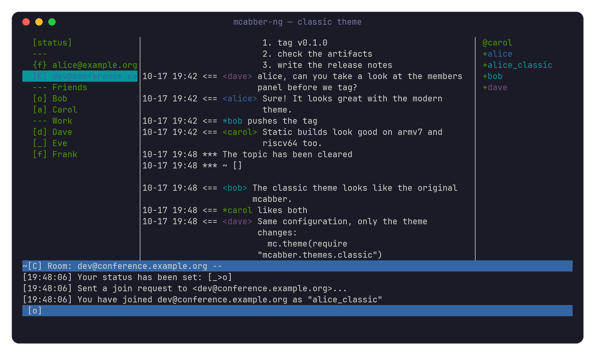

# mcabber-ng

**mcabber-ng** is a Jabber (XMPP) client for the terminal, based on
[mcabber](https://mcabber.com/). It keeps what made mcabber good — small,
fast, keyboard driven — and adds a Lua configuration, multi-line messages,
safe pasting and a modern, themable interface.



## Features

- **Lua configuration** — `~/.config/mcabber-ng/init.lua` is a Lua script:
  options, aliases, key bindings, event handlers, timers, formats, themes.
- **Readable key bindings** — `mc.bind("Alt+j", "roster down")` instead of
  `bind M106 = …`; keys can also run Lua functions.
- **Event handlers** — react to incoming and outgoing messages, status
  changes, connections…; modify or drop messages (`mc.on("message_in", …)`).
- **Multi-line messages** — <kbd>Alt</kbd>+<kbd>Enter</kbd> inserts a line
  break, the input line grows as you type.
- **Safe pasting** — pasted text goes to the input line instead of being
  sent line by line (bracketed paste, or detection of fast input).
- **Configurable display** — templates or Lua functions for messages, roster
  items, status lines and the input prompt.
- **Themes** — frames with rounded corners, 256 and 24-bit colors, status
  icons; `modern` and `classic` themes are included, plus the color themes
  of mcabber.
- **Room members panel** — next to the chat window, or over it.
- **XMPP console** — watch the XML stream and send raw stanzas.
- **Rooms and reconnections** — the room history is not received again
  when you rejoin, lost connections (and sleep) are recovered by
  themselves, rooms are joined again; a panel shows and edits the
  bookmarks.
- **External editor** — <kbd>Alt</kbd>+<kbd>e</kbd> edits the message in
  `$EDITOR`; inside tmux the editor opens in a pane next to mcabber-ng.
- **Link hints** — <kbd>Alt</kbd>+<kbd>o</kbd> labels the links of the chat
  window, wrapped ones included; type a label to open the link.
- **OMEMO** — end-to-end encryption of one-to-one chats, compatible with
  Conversations, Dino, Gajim and Profanity; messages are encrypted
  automatically for contacts who use it.
- All the features of mcabber: MUC, PGP, OTR, history logging, chat
  states, message carbons, delivery receipts, modules…

<table>
  <tr>
    <td></td>
    <td></td>
  </tr>
  <tr>
    <td align="center">Multi-line messages and input</td>
    <td align="center">XMPP console (<code>/console</code>)</td>
  </tr>
  <tr>
    <td colspan="2"></td>
  </tr>
  <tr>
    <td colspan="2" align="center">The <code>classic</code> theme: the original mcabber look</td>
  </tr>
</table>

## Installation

### Packages and static binaries

Each [release](https://github.com/h5vx/mcabber-ng/releases) provides:

| | Files |
|---|---|
| Debian, Ubuntu and derivatives, any release (amd64, i386, arm64, armhf, riscv64) | `mcabber-ng_*.deb` |
| Fedora 42 (x86_64, aarch64) | `mcabber-ng-*.rpm` |
| Arch Linux (x86_64) | `mcabber-ng-*.pkg.tar.zst` |
| Any Linux: x86_64, x86, aarch64, armv7, riscv64 | `mcabber-ng-*-linux-ARCH-static.tar.gz` |

The `.deb` packages and the static binaries have no dependencies (they are
built with musl), and the static archives can be extracted anywhere
(usually in `/usr/local`). They are built without modules, PGP, IDN and
spell checking; build from source to get them.

```sh
sudo apt install ./mcabber-ng_*_amd64.deb
# or
sudo tar -C /usr/local -xzf mcabber-ng-*-linux-x86_64-static.tar.gz
```

### Building from source

Dependencies: GLib, ncursesw, Loudmouth, LuaJIT (or Lua 5.1), and
optionally libomemo-c (or libsignal-protocol-c) with libgcrypt for OMEMO,
GPGME, libidn, Enchant (spell checking) and libotr.

```sh
# Debian / Ubuntu
sudo apt install autoconf automake libtool pkg-config libncurses-dev \
  libglib2.0-dev libloudmouth1-dev libluajit-5.1-dev libgpgme-dev \
  libidn-dev libenchant-2-dev libomemo-c-dev libgcrypt20-dev

cd mcabber
./autogen.sh
./configure --enable-enchant      # --with-lua=lua5.1 to use PUC Lua
make
make check                        # unit tests
sudo make install
```

## Getting started

Copy the sample configuration and set your JID:

```sh
mkdir -p ~/.config/mcabber-ng
cp /usr/share/mcabber-ng/init.lua.example ~/.config/mcabber-ng/init.lua
$EDITOR ~/.config/mcabber-ng/init.lua
mcabber-ng -n      # check the configuration and print the settings
mcabber-ng
```

(`/usr/local/share/…` if you built it yourself.) A minimal configuration:

```lua
mc.set {
  jid = "alice@example.org",
  password_eval = "pass show xmpp/alice",   -- or let mcabber-ng ask
}
mc.theme(require "mcabber.themes.modern")
```

## Configuration

The configuration file is plain Lua; everything goes through the `mc`
table. A few examples:

```lua
-- Options (strings, numbers or booleans)
mc.set { roster_width = 28, logging = true, load_logs = true }
mc.opt.nickname = "alice"

-- Aliases and key bindings
mc.alias { me = "say /me", away = "status away" }
mc.bind {
  ["Alt+j"]  = "roster down",
  ["Alt+k"]  = "roster up",
  ["F5"]     = "roster toggle_offline",
  ["Ctrl+q"] = "roster unread_next",
}
mc.bind("Alt+s", function() mc.input.insert("¯\\_(ツ)_/¯") end)

-- Events: join a room once connected, filter messages, notifications
mc.on("connect", function()
  mc.command("room join dev@conference.example.org alice")
end)

mc.on("message_in", function(ev)
  if ev.jid == "spammer@example.org" then return mc.DROP end
  ev.text = ev.text:gsub(":shrug:", "¯\\_(ツ)_/¯")
end)

mc.on("message_received", function(ev)
  if ev.delayed or ev.own or ev.active then return end
  if not ev.muc or ev.highlight then
    os.execute(("notify-send %s %s &"):format(
      mc.shell_quote(ev.nick or ev.jid), mc.shell_quote(ev.text)))
  end
end)

-- Message format: templates or Lua functions
mc.format.time = "%H:%M"
mc.format.message = {
  default = "{#timestamp}{time}{#} {#nick}{nick:>10.10}{#} │ ",
  info    = "{#timestamp}{time}{#}            * ",
}

-- Styles and themes
mc.theme(require "mcabber.themes.modern")
mc.style("msgout", "fg=#7dcfff")
mc.style("timestamp", { fg = "#565f89", italic = true })
```

`/lua` runs Lua code at runtime (`/lua mc.get("roster_width")`), and
`/source` runs a Lua file. Lua modules can be put in
`~/.config/mcabber-ng/lua/`.

### Themes

| Theme | |
|---|---|
| `modern` | Rounded frames, a dark 24-bit palette (approximated on 256-color terminals), status icons, a status line made of rounded "islands" |
| `classic` | The original mcabber look |
| `colorcli`, `light`, `light2`, `mikael-256`, `oliver` | The color themes of mcabber |

The islands of the `modern` theme use Powerline glyphs (a
[Nerd Font](https://www.nerdfonts.com/) is needed). Other characters can be
used:

```lua
mc.theme(require("mcabber.themes.modern").with { caps = { "▐", "▌" } })
mc.theme(require("mcabber.themes.modern").with { caps = false })  -- none
```

### Interface options

| Option | |
|---|---|
| `ui_borders` | `rounded`, `single`, `double`, `heavy`, `ascii` or `none` |
| `input_position` | `chat` (below the chat window, default) or `bottom` |
| `input_max_rows` | Maximum height of the input line (default 6) |
| `muc_members` | `column` (default), `overlay` or `none` |
| `paste_mode` | `insert` (default), `confirm` or `send_lines` |
| `ui_colors` | `auto`, `8`, `16`, `256` or `truecolor` |

## Keys

| Key | |
|---|---|
| <kbd>Enter</kbd> | Send the message (or run the command) |
| <kbd>Alt</kbd>+<kbd>Enter</kbd>, <kbd>Ctrl</kbd>+<kbd>j</kbd> | New line in the message |
| <kbd>Up</kbd> / <kbd>Down</kbd> | Previous/next row of the input line, then history |
| <kbd>PgUp</kbd> / <kbd>PgDn</kbd> | Move in the roster |
| <kbd>Ctrl</kbd>+<kbd>p</kbd> / <kbd>Ctrl</kbd>+<kbd>n</kbd> | Scroll the chat window |
| <kbd>Tab</kbd> | Completion |
| <kbd>Esc</kbd> | Leave the chat mode |
| <kbd>F1</kbd> | Help |

Unbound keys are reported in the log window with their name (for example
`Unknown key: Alt+x`), ready to be used with `mc.bind` or `/bind`.

## Commands

All the mcabber commands are available (`/help` lists them). New ones:

| Command | |
|---|---|
| `/lua CODE` | Run Lua code |
| `/members [show\|hide\|toggle]` | Members of the current room |
| `/console [show\|hide\|toggle\|clear]` | XMPP console; text typed while it is displayed is sent as raw XML |
| `/bind KEY = COMMAND` | Bind a key, by name |
| `/omemo [info\|on\|off\|trust…]` | OMEMO encryption: devices, fingerprints, trust |
| `/bookmarks` | Panel of the room bookmarks: join, auto-join, edit, delete |
| `/editor` | Edit the message in `$EDITOR` (<kbd>Alt</kbd>+<kbd>e</kbd>); in tmux, in a pane next to mcabber-ng |
| `/url [command]` | Label the links of the chat window (<kbd>Alt</kbd>+<kbd>o</kbd>) and open the chosen one |

## Documentation

- The manual page: `man mcabber-ng` ([source](mcabber/doc/mcabber-ng.1.txt))
  — Lua API, events, formats, styles, key names.
- The sample configuration, with all the options:
  [`init.lua.example`](mcabber/init.lua.example).
- `/help COMMAND` in mcabber-ng.

## Coming from mcabber

The configuration format is not compatible: mcabber-ng reads
`~/.config/mcabber-ng/init.lua`, not `~/.mcabber/mcabberrc`. Most lines
translate directly: `set foo = bar` becomes `mc.set { foo = "bar" }`,
`bind 269 = …` becomes `mc.bind("F5", "…")`, and other commands can be run
with `mc.command("…")`. History files have the same format.

## License

mcabber-ng is free software, released under the GNU General Public License
version 2 or later (see [COPYING](mcabber/COPYING)). It is based on mcabber
by Mikael Berthe and the mcabber contributors.
